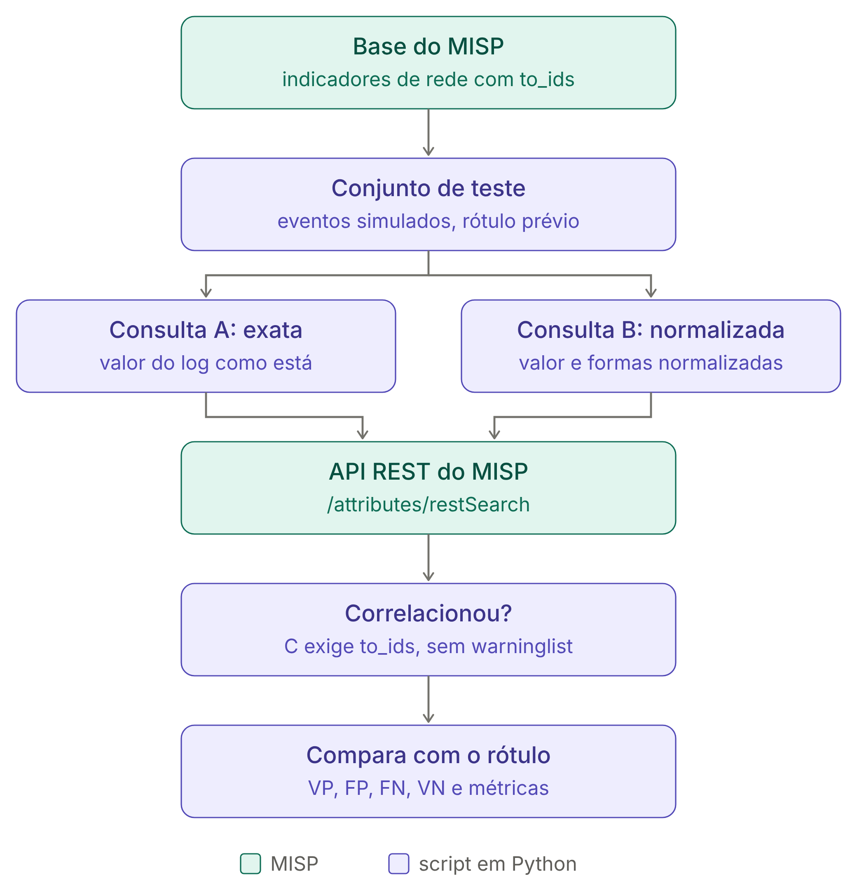

# Teste de correlação de IoCs com o MISP: scripts e dados do TCC

Material de apoio do Trabalho de Conclusão de Curso **Cyber Threat Intelligence: implementando um ambiente baseado em uma plataforma open source**, de Rafael Moreira de Lana, sob orientação de Marcelo Santos Daibert (Ciência da Computação, Centro Universitário Governador Ozanam Coelho – UNIFAGOC, 2026).

O repositório reúne os dois scripts em Python usados no laboratório, o conjunto de teste rotulado e os relatórios que servem de base aos Quadros 4, 5 e 7 a 9 do TCC.

> **Atenção:** os arquivos das pastas `dados/` e `resultados/` contêm indicadores de comprometimento reais (IPs, domínios e URLs maliciosos), vindos de eventos públicos do MISP marcados como TLP:CLEAR ou TLP:WHITE. Não acesse esses endereços. Os scripts também não os acessam: apenas comparam valores dentro do MISP.

## Conteúdo

```
tcc-cti-misp/
├── scripts/
│   ├── coleta_tcc.py                        coleta de dados do ambiente e da base do MISP
│   └── correlacao_tcc.py                    teste de correlação de eventos de rede com IoCs
├── dados/
│   └── conjunto_teste_20261029_214348.csv   conjunto de teste rotulado (29 out. 2026)
├── resultados/
│   ├── 2026-10-24/                          ensaio funcional (em repouso e após a publicação)
│   └── 2026-10-29/                          base final (coleta e teste de correlação)
├── docs/
│   └── fluxo_teste_correlacao.png           fluxo do teste (Figura 1 do TCC)
└── SHA256SUMS.txt                           hashes para conferir a integridade dos arquivos
```

Os relatórios estão exatamente como foram gerados pelos scripts.

## Ambiente do laboratório

- Computador com Intel Core i3-1115G4 e 12 GB de RAM, com Windows e WSL 2 (cerca de 5,8 GB de memória disponíveis ao Ubuntu, limite padrão sem `.wslconfig`).
- Ubuntu 24.04.5 LTS, MISP 2.5.48 sem contêineres (Apache 2.4.58, PHP 8.3.6, MariaDB 10.11.14 e Redis 7.0.15) e misp-dashboard (commit 3c11250) recebendo os eventos por ZeroMQ.
- Python 3.12.3. Os scripts usam apenas a biblioteca padrão, então não há nada a instalar.
- Base final, congelada em 29 out. 2026: 6 eventos importados de *feeds* públicos, 1.582 atributos e 76 indicadores de rede marcados para detecção (`to_ids`), sendo 18 IPs, 48 domínios e 10 URLs.

## Como executar

### Pré-requisitos

1. Um MISP em execução, acessível pelo Ubuntu. O endereço padrão dos scripts é `https://misp.local`; para outro endereço, use a opção `--url`.
2. Uma chave de API **somente de leitura**. No MISP, em *Global Actions → My Profile → Auth keys*, clique em *Add authentication key* e marque *Read only*. A chave aparece uma única vez; apague-a depois do uso.

Copie a pasta para o Ubuntu (ou clone o repositório) e entre nela:

```bash
cd tcc-cti-misp
```

### 1. Coleta do ambiente e da base

```bash
sudo python3 scripts/coleta_tcc.py               # coleta completa (pede a chave de API)
sudo python3 scripts/coleta_tcc.py --recursos    # só versões e consumo de recursos, sem API
```

O `sudo` é necessário para ler o consumo dos serviços e o uso de disco do banco de dados. A coleta completa registra as versões dos componentes, a memória residente de cada serviço, a ocupação da CPU (média de 5 s) e o uso de disco e, pela API, os *feeds* configurados, os eventos e atributos por organização de origem, a repetição de indicadores entre fontes e eventos, as ocorrências em *warninglists* e o tempo de resposta em 30 consultas.

Saída, na pasta atual: `coleta_tcc_completa_AAAAMMDD_HHMMSS.txt` e `.json` (ou `coleta_tcc_recursos_...`, com `--recursos`).

### 2. Teste de correlação

```bash
python3 scripts/correlacao_tcc.py                     # sorteia um conjunto novo (semente 42) e executa o teste
python3 scripts/correlacao_tcc.py --conjunto dados/conjunto_teste_20261029_214348.csv   # repete o teste do TCC
```

Saída, na pasta atual:

- `conjunto_teste_AAAAMMDD_HHMMSS.csv`: conjunto rotulado (só quando um conjunto novo é sorteado);
- `correlacao_tcc_AAAAMMDD_HHMMSS.txt`: relatório com as métricas por estratégia, os erros, as *warninglists*, os tempos e o resultado de cada evento;
- `correlacao_tcc_AAAAMMDD_HHMMSS.csv`: detalhe por evento.

A opção `--real ARQUIVO` acrescenta observáveis reais, um por linha (por exemplo, o cache DNS do Windows), sem rótulo. Ela não foi usada no TCC, e os arquivos gerados com ela passam a conter dados do seu computador; não os publique.

## Como o teste funciona



1. O script lê, pelo recurso `/attributes/restSearch` da API do MISP, os indicadores de rede marcados com `to_ids`: IP, domínio ou nome de host e URL.
2. Com a semente 42, sorteia até 20 indicadores, distribuídos entre os tipos, e gera dois eventos simulados a partir de cada um: um no formato original e outro no formato comum em registros (IP com porta, nome DNS em maiúsculas com ponto final, domínio dentro de URL ou URL com o nome do servidor em maiúsculas). Acrescenta 34 valores benignos (resolvedores DNS públicos, endereços privados e sítios populares) e rotula todos antes das consultas.
3. Consulta cada evento no MISP com três estratégias: **A**, o valor exato do registro; **B**, o valor original e suas formas normalizadas (sem porta, sem ponto final, em minúsculas e, em URLs, o nome do servidor), em uma única requisição; e **C**, a resposta de B filtrada, que só gera alerta para atributo com `to_ids` e fora de *warninglist*.
4. Um evento é considerado correlacionado quando a consulta retorna ao menos um atributo. O script compara cada decisão com o rótulo, conta verdadeiros e falsos positivos e negativos, calcula precisão e revocação e mede o tempo de cada requisição.

Nenhum IP, domínio ou URL do conjunto é acessado: o MISP só compara valores.

## Resultados de 29 out. 2026

Teste com 74 eventos simulados: 20 positivos no formato original, 20 positivos com variação de formato e 34 negativos.

| Estratégia | VP | FP | FN | VN | Precisão | Revocação | F1 |
|---|---:|---:|---:|---:|---:|---:|---:|
| A – consulta exata | 26 | 0 | 14 | 34 | 100% | 65% | 0,79 |
| B – consulta normalizada | 40 | 0 | 0 | 34 | 100% | 100% | 1,00 |
| C – normalizada com filtros | 38 | 0 | 2 | 34 | 100% | 95% | 0,97 |

O F1 foi calculado a partir da precisão e da revocação do relatório. Tempo por consulta (n = 74, uma execução): na estratégia A, média de 79,9 ms e mediana de 75,8 ms; na B, média de 86,2 ms e mediana de 79,0 ms.

## Correspondência com o TCC

| Arquivo | Onde é usado no TCC |
|---|---|
| `resultados/2026-10-24/coleta_tcc_completa_20261024_193238.txt` | Quadro 5, coluna "Repouso 1" |
| `resultados/2026-10-24/coleta_tcc_recursos_20261024_193552.txt` | Quadro 5, coluna "Repouso 2" |
| `resultados/2026-10-24/coleta_tcc_recursos_20261024_194230.txt` | Quadro 5, coluna "Após publicação" |
| `resultados/2026-10-29/coleta_tcc_completa_20261029_214314.txt` | Quadro 4 (versões e disco), Quadro 5 (coluna "Base final") e Quadro 7 (eventos) |
| `resultados/2026-10-29/correlacao_tcc_20261029_214348.txt` e `.csv` | Seção 5.3 e Quadros 8 e 9 |
| `dados/conjunto_teste_20261029_214348.csv` | Conjunto rotulado do teste da seção 5.3 |

Na coleta de 24 out. 2026, a base ainda estava em formação; a base final, usada nas medições do estudo de caso, é a de 29 out. 2026.

## Formato dos arquivos CSV

Os arquivos são separados por ponto e vírgula, em UTF-8 com BOM, para abrir corretamente no Excel.

**Conjunto de teste** (`dados/conjunto_teste_20261029_214348.csv`):

| Coluna | Conteúdo |
|---|---|
| `id` | identificador do evento simulado (E001, E002...) |
| `grupo` | positivo exato, positivo com variacao ou negativo |
| `variacao` | tipo de variação de formato, ou `-` |
| `categoria` | IP, Dominio ou URL |
| `evento_simulado` | registro simulado, como `conexao 192.168.0.10 -> 203.0.113.10:443`, `consulta DNS EXEMPLO.COM.` ou `HTTP GET http://exemplo.com/index.php` (192.168.0.10 é um endereço fictício do laboratório) |
| `observavel` | valor consultado no MISP |
| `indicador` | valor original do indicador na base, ou `-` nos negativos |
| `rotulo` | malicioso ou benigno, definido antes das consultas |

**Detalhe por evento** (`correlacao_tcc_*.csv`): as mesmas colunas, mais `A`, `B` e `C` (S quando a estratégia correlacionou), `ms_A` e `ms_B` (tempo das requisições, em ms), `eventos` e `fontes` das correspondências, `to_ids` e as *warninglists* da correspondência e do observável.

## Integridade dos arquivos

O arquivo `SHA256SUMS.txt` lista o hash SHA-256 de cada arquivo das pastas `scripts/`, `dados/`, `resultados/` e `docs/`. Para confirmar que nenhum deles foi alterado, rode no Ubuntu, na raiz do repositório:

```bash
sha256sum -c SHA256SUMS.txt
```

Todas as linhas devem terminar em `OK`. O `.gitattributes` impede que o Git converta o fim de linha dos arquivos, o que mudaria os hashes.

## Reprodutibilidade e limites

- Os resultados dependem do estado da base do MISP e das *warninglists*, congelado em 29 out. 2026. Com o mesmo conjunto (`--conjunto`), outra base pode produzir resultados diferentes.
- Os positivos vêm da própria base, e os negativos, de fora dela. As métricas validam a implementação da correlação, mas não medem a eficácia de detecção nem a taxa de falso alerta em operação.
- As medidas de consumo e de tempo são pontuais, de uma única execução, e não caracterizam desempenho estável nem escalabilidade.
- Os scripts não verificam o certificado TLS, porque o laboratório usa um certificado autoassinado. Use-os apenas contra um MISP local de testes.

## Segurança

- A chave de API é digitada na execução, sem aparecer na tela, e não é gravada em nenhum arquivo.
- Use uma chave somente de leitura e apague-a depois do uso.
- O `.gitignore` impede que saídas novas, geradas ao rodar os scripts na raiz do repositório, sejam enviadas por engano.

## Como citar

LANA, Rafael Moreira de. **Cyber Threat Intelligence**: implementando um ambiente baseado em uma plataforma open source. 2026. Trabalho de Conclusão de Curso (Graduação em Ciência da Computação) – Centro Universitário Governador Ozanam Coelho, Ubá, 2026.

## Licença

Os scripts estão sob a licença MIT (ver `LICENSE`). Os indicadores dos arquivos de dados e de resultados vêm de eventos públicos do catálogo padrão do MISP e seguem as condições das fontes originais.
